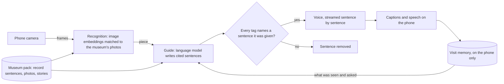

# The Agentic Archaeologist

An open-source AI museum guide that runs in the phone's web browser. Point the camera at a piece: the guide recognises it, tells its story aloud, answers spoken questions, remembers the visit and links each new piece to the ones seen before. Everything it says comes from the museum's own records.

Presented at CAA-UK 2026, University of Glasgow (26 November 2026): "The Agentic Archaeologist: an open-source AI guide that remembers its visitor", Baqar Jafri, University of Stirling.

## Why a museum can let it speak:
- **It speaks only from the museum's records.** Each fact the guide says carries a tag naming the record sentence it came from, and the visitor can tap the tag to read that sentence. Before a sentence is spoken, the server removes it if its tag names anything the guide was not given (`server/app/guide/validate.py`).
- **It says when the record is silent.** Asked something the record does not answer, it says the record does not say, instead of guessing.
- **Knowledge stays with the museum.** A museum's content lives in a *pack* that the museum writes and owns: the text of its records split into citable sentences, its photographs, and the stories its curators choose to tell. Packs are not part of this repository.
- **Memory stays with the visitor.** What a visitor has seen and asked is kept on their own phone (IndexedDB). The server holds no visit record; to answer, it sends the question and the relevant record sentences to a language model service.

## Demo:
A recorded session from the Museum of Archaeology and Anthropology (MAA), University of Cambridge, will be linked here. It was recorded inside the app, with the author's gallery film played in place of the camera; the recognition, the answers and the voice are the app working as it does live. Object information comes from MAA's public online catalogue and is shown for research and non-commercial purposes; the content belongs to MAA. The MAA pack itself is not published.

## How it works:

- **`web/`:** the phone app (React 19, Vite, TypeScript). It votes over camera frames to recognise a piece, plays the streamed voice, takes push-to-talk questions and keeps the visit memory on the phone.
- **`server/app/`:** the FastAPI service. Recognition uses DINOv2-small (int8 ONNX) embeddings matched against the pack's reference photos, with a threshold and a margin from the pack's calibration. The guide uses a language model (Gemini through its OpenAI-compatible endpoint by default) and a voice (Gemini TTS, or ElevenLabs).
- **`server/builder/`:** builds a pack from a museum's online records, then its embeddings and calibration. Two record adapters exist: Glasgow Museums (`records.py`) and the MAA collections database (`records_maa.py`, with `build_pack_maa.py`).
- **`Dockerfile`:** one container for the API and the built web app.

## Packs:
A pack holds everything the guide may say about a set of pieces; `packs/README.md` documents the layout and `curation.json`. No pack is included, because museum content stays with the museum. To run the guide, build a pack from records you have the right to use:

    cd server
    uv run python -m builder.build_pack ../packs/<pack>              # Glasgow Museums records
    uv run python -m builder.build_pack_maa ../packs/<pack>          # MAA records, website quotes and video frames
    uv run python -m builder.video_frames ../packs/<pack> <videos>   # frames from your own gallery footage
    uv run python -m builder.embeddings ../packs/<pack> models/dinov2-small-int8.onnx
    uv run python -m builder.calibrate ../packs/<pack> models/dinov2-small-int8.onnx --frames ../packs/<pack>/calibration-frames

The builder refuses to write a pack if any story anchor does not match exactly one sentence of the record, and the MAA builder checks every website quote word for word on the live page.

## First results (21 November 2026):
- **Recognition, MAA pack:** on held-out frames from the gallery film, the right piece ranked first in 18 of 18; at the chosen threshold (0.77, margin 0.15) 16 of 18 were accepted and none of 24 frames of other objects in the same galleries. References and tests come from one walk-through, so these scores overstate a fresh visit.
- **Grounding, 15 scripted conversations across two museums' packs:** no sentence was removed, and all 41 factual sentences carried a tag to a record sentence the guide was given. Read by hand against the record, 19 of the 20 cited sentences from the MAA conversations said only what the record says; one added a name from outside the record.
- **Honest silence:** of three questions the records cannot answer, the guide said so twice and once gave only what the record has.
These are small first samples from one film and the author's own script, not a visitor study.

## Run locally:
Needs Python 3.12 with [uv](https://docs.astral.sh/uv/), Node 22, a pack in `packs/<pack>/`, and a Gemini API key.

    cd server
    uv sync
    uv run python scripts/fetch_model.py
    cp .env.example .env        # fill in GEMINI_API_KEY
    PACK_DIR=../packs/<pack> uv run uvicorn app.main:create_app --factory --env-file .env --port 8000

    cd web
    npm ci
    npm run dev                 # proxies /api, /pack-assets, /test-gallery and /ws to 127.0.0.1:8000

`server/.env.example` lists every setting with its default; `ACCESS_CODES` gates the API behind a code in the QR link.

Tests:

    cd server && uv run pytest -q -m "not slow"
    cd web && npm test && npx tsc --noEmit

Tests that read a real museum pack skip when the pack is not present.

## Laptop demo with gallery footage:
Footage filmed in a gallery can stand in for the phone camera, and the app records the session itself.

1. Prepare the footage, from `server/`: `uv run python scripts/make_tour.py <folder>/tour-cuts.json <tour folder>`. `tour-cuts.json` lists the source videos and, per video, `walk` and `hover` ranges in seconds; each hover names its piece. Hovers become seamless back-and-forth loops, so the footage holds on a piece for as long as the conversation lasts.
2. Build the web app (`npm run build` in `web/`), then start the server with `PACK_DIR=../packs/<pack> DEMO_DIR=<tour folder>`.
3. In Chrome, open `http://localhost:8000/?demo=1`, press F11 and wear headphones.

| Key | Does |
|---|---|
| Enter | taps the main button (Tell me) |
| Space, held | asks a question: listens while held, sends on release |
| → | walks on to the next piece |
| R | starts recording (Chrome asks to share this tab), and stops and saves it |
| Esc | closes an open sheet |

The recording holds only the phone frame, with the guide's voice and the microphone mixed into one track. Without `?demo=1` the app is unchanged.

## Next:
Planning a route through a gallery, adapting to a child or a specialist, camera glasses, guides at excavation sites, an example pack built from openly licensed collection data, and a visitor study.

## Licence and credits:
- Code: Apache License 2.0 (`LICENSE`). Museum content, packs and photographs are not covered and are not included.
- Pilot content: Glasgow Museums (Burrell Collection). Second pack: Museum of Archaeology and Anthropology, University of Cambridge, from its public online catalogue, for research. Neither museum endorses this project.
- Citation: see `CITATION.cff`.
